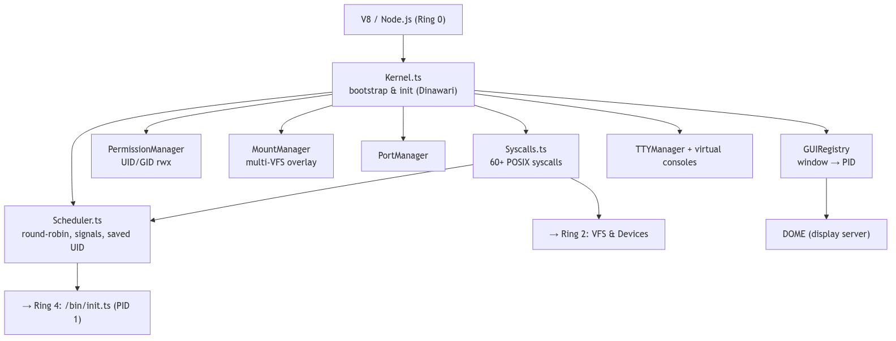
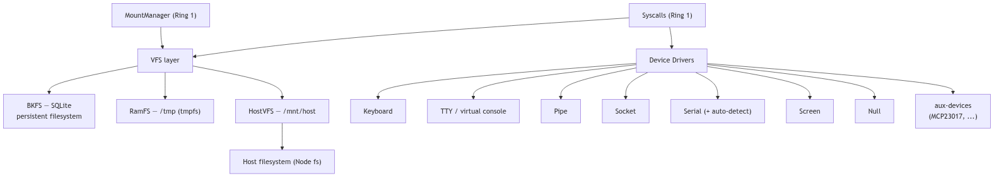
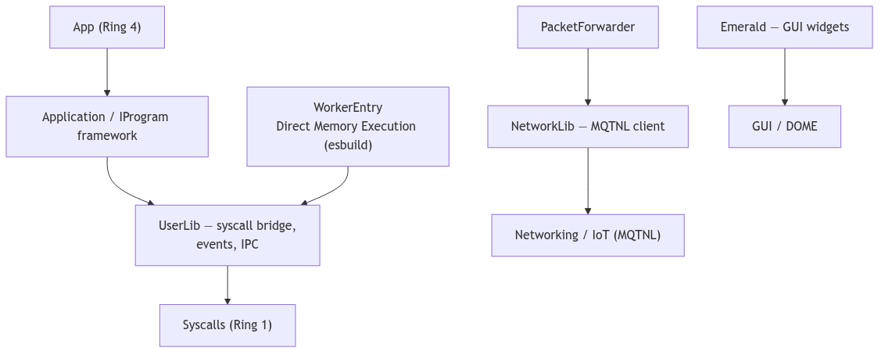
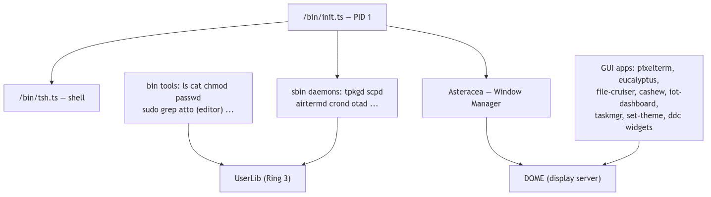
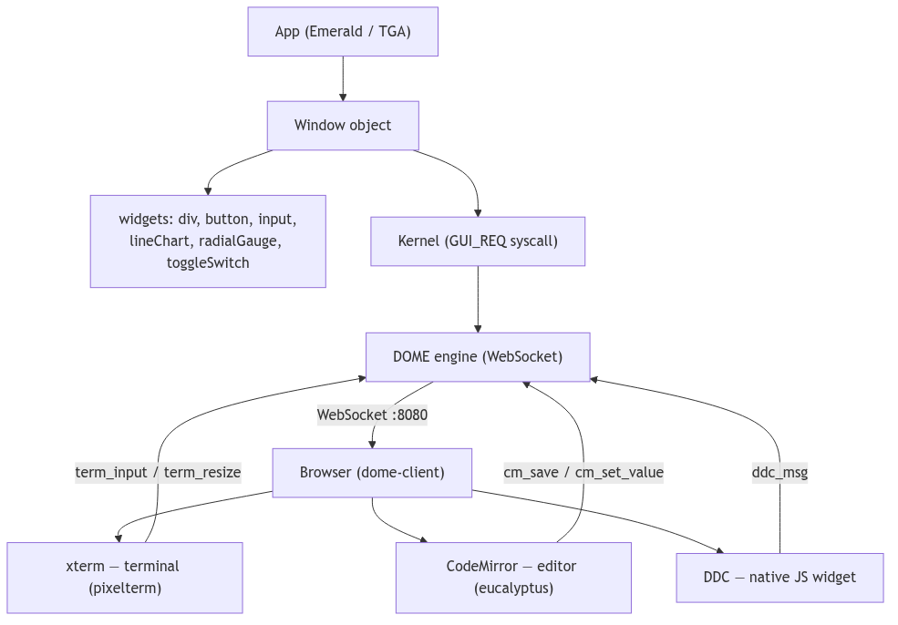
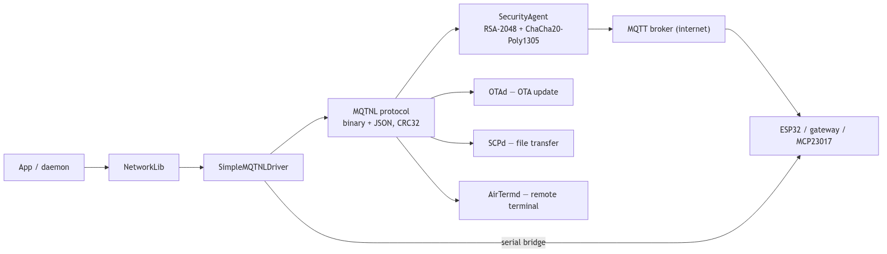
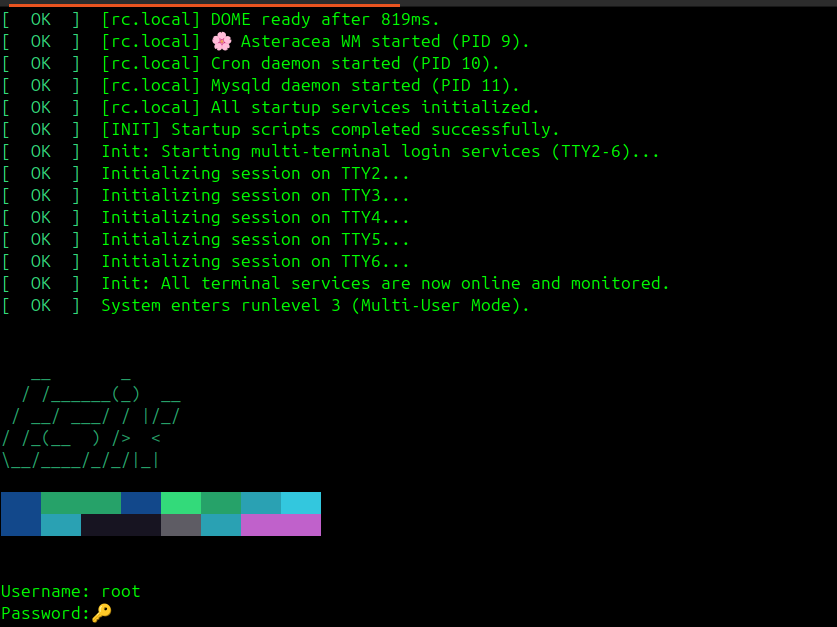
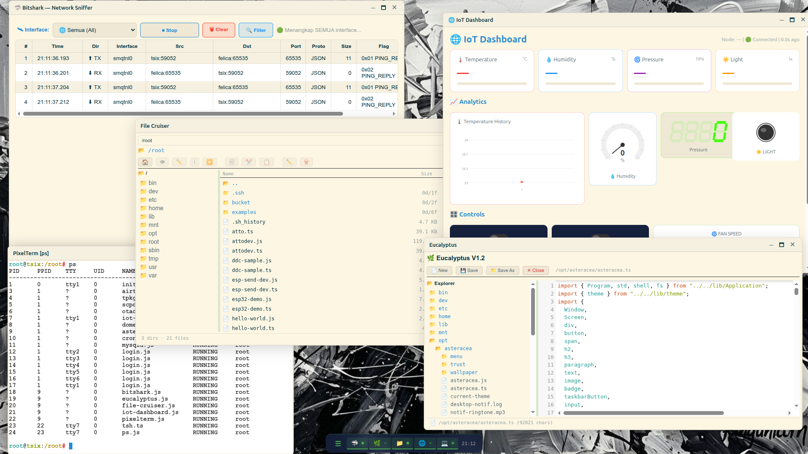
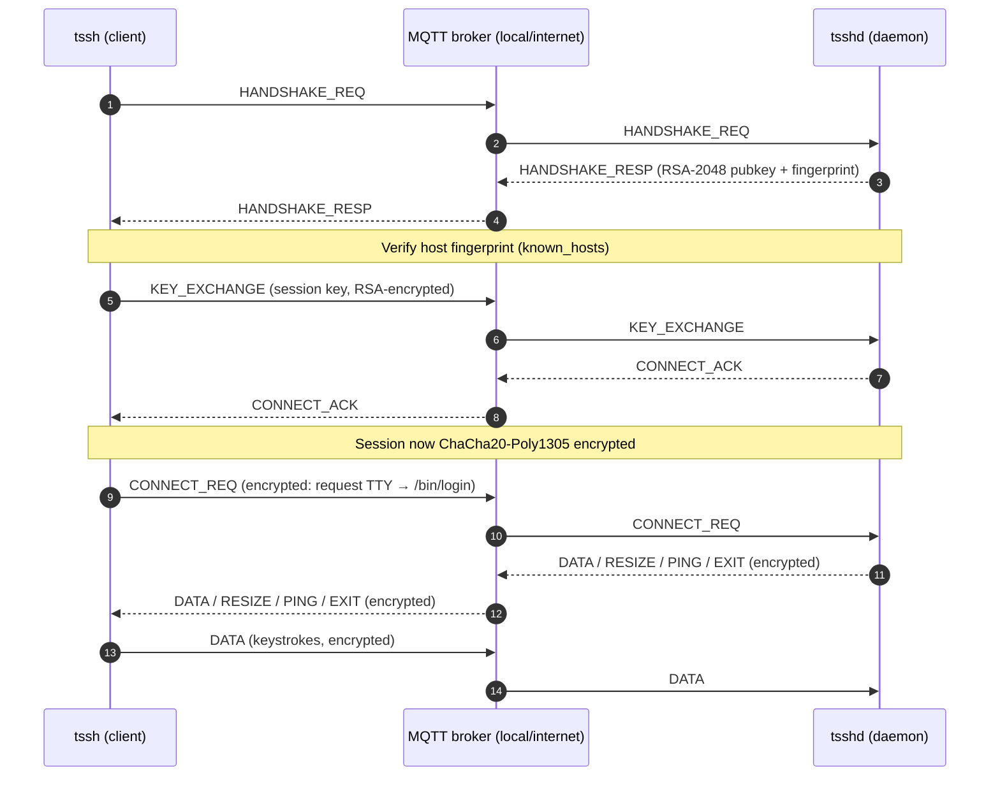

# TSIX

<p align="center">
  
  
  
  
</p>

**TSIX** is an **operating system simulator** built entirely in TypeScript on top of Node.js/V8 — complete with a custom kernel, syscall dispatcher, logical Unix-style permission layer (UID/GID, rwx), POSIX-like filesystem, signal handling, and device abstraction (HAL). It is **not a VM that emulates a CPU**; it simulates OS concepts — tasks/processes, permissions, filesystems, signals — directly within the Node.js runtime as an educational and experimental project, and follows **Unix fidelity** as its design north star (see [Philosophy](#philosophy)).

Its flagship use case is a complete **IoT stack** — the MQTNL protocol (MQTT-based), **Lantana** (the bundled, ready-to-use IoT stack; optional), OTA firmware updates, real-time dashboards, and encrypted remote terminal access — all reachable with nothing more than an internet connection and a free MQTT broker. No VPS, no static public IP, no paid cloud service required.

**Where IoT fits (and where it doesn't):** the IoT stack is **not** part of the kernel. TSIX's core — kernel, VFS, drivers (rings 1–2) — is generic within the simulator's ecosystem: it has no idea what MQTT, OTA, or ESP32 are. The IoT stack is simply **one application running on top of the platform**, exactly like the window manager, the file browser, or the shell. That separation *is* the design's strength: one neutral, Unix-faithful core powers any generic simulated task — be it IoT, a desktop environment, or a command line.

TSIX keeps evolving, so expect rough edges and breaking changes between versions.

> [!WARNING]
> **Experimental — not for production.** See [Security status](#security-status-experimental) before connecting TSIX or your devices to a public MQTT broker.

<p align="center">
  
  <br>
  <em>Ring 1 — Kernel Core (Syscalls, Scheduler, Permission, Mount, GUI Registry).</em>
</p>

<p align="center">
  
  <br>
  <em>Ring 2 — HAL &amp; File System (BKFS, RamFS, HostVFS, device drivers).</em>
</p>

<p align="center">
  
  <br>
  <em>Ring 3 — User Libraries (UserLib, NetworkLib, Emerald, WorkerEntry).</em>
</p>

<p align="center">
  
  <br>
  <em>Ring 4 — Applications (init, shell, daemons, Asteracea WM, GUI apps).</em>
</p>

<p align="center">
  
  <br>
  <em>GUI / Display Pipeline (Emerald → kernel → DOME → browser).</em>
</p>

<p align="center">
  
  <br>
  <em>Networking &amp; IoT Stack (MQTNL → E2E → MQTT → OTA/SCP/TSSH/ESP32).</em>
</p>

<p align="center">
  
  <br>
  <em>TSIX console — TTY login &amp; shell.</em>
</p>

<p align="center">
  
  <br>
  <em>Asteracea Window Manager — desktop environment (taskbar, launcher, apps).</em>
</p>

### Why TSIX exists

This project started in 2021 as a way to remotely manage home automation — lights controlled/monitored by a Raspberry Pi, MCP23017, and relays — while living between two cities and only being home on weekends. Renting a VPS with a static public IP just to check on the lights wasn't worth it. What began as a small utility (originally called **NOS**) grew, over several years, into TSIX: a full operating-system-style platform with an IoT stack as its most complete, most battle-tested application.

---

## Key Features

### Kernel

| Feature                | Detail                                                                                                     |
| ---------------------- | ---------------------------------------------------------------------------------------------------------- |
| **Syscall Dispatcher** | 60+ POSIX-inspired syscalls (OPEN, READ, WRITE, EXEC, WAITPID, SIGNAL, CHMOD...)                           |
| **Scheduler**          | Process manager: PCB states, wait queue, signals (SIGKILL, SIGTERM, SIGINT, SIGSTOP...) — each process runs in its own Worker Thread |
| **Permission Manager** | UID/GID, rwx bits, root bypass, SetUID & Saved UID (suid) support                                          |
| **Mount Manager**      | Multi-VFS overlay, bind mount, union mount, nested mount points                                            |
| **Process Tree**       | Parent-child links, orphan auto-reparent to init, zombie prevention                                        |
| **IPC**                | Built-in `SEND_MSG` syscall + UUID-based identity messaging                                                |

### Filesystem (VFS)

| Feature               | Detail                                                                          |
| --------------------- | ------------------------------------------------------------------------------- |
| **BKFS (SQLite VFS)** | Persistent filesystem in a single `.db` file, path traversal via parent_id tree |
| **RAM VFS**           | In-memory tree for the root filesystem (tmpfs-like)                             |
| **HostVFS**           | Bridge to the host filesystem (`/mnt/host`) via Node.js `fs`                    |
| **Chunked I/O**       | `readChunk`/`writeChunk` for progress-aware file operations                     |
| **Unix Permissions**  | Owner/group/others, mode rwx, SetUID bit                                        |

### Networking

| Feature            | Detail                                                                   |
| ------------------ | ------------------------------------------------------------------------ |
| **MQTNL Protocol** | Binary + JSON encoding, CRC32 validation, magic bytes, version handshake |
| **E2E Encryption** | RSA-2048 handshake + ChaCha20-Poly1305 session encryption                |
| **OTA Updates**    | Over-the-air firmware update via MQTNL protocol                          |
| **SCP**            | Secure file transfer with encryption + password authentication           |
| **TSSH**           | Encrypted remote terminal to a TSIX node from anywhere — internet + MQTT broker only, **no public IP / VPS required**. SSH-like RSA-2048 handshake → ChaCha20-Poly1305 session (successor of AirTerm) |

### Remote Terminal — TSSH (no VPS, no public IP)

**TSSH** is TSIX's encrypted remote terminal (secure shell). Unlike classic SSH, it
**does not need a VPS, a static public IP, or port-forwarding** — it rides on top of
the MQTT broker, which TSIX already speaks natively. The broker can be **local
(LAN)** or **public (internet)** — as long as both sides can reach it, they can
connect.

```
┌─────────────┐        MQTT broker         ┌─────────────┐
│  tssh (client) │  ───── local / internet ───▶  │  tsshd (daemon)  │
│  any TSIX node │                            │  target TSIX node │
└─────────────┘                            └─────────────┘
      │                                          │
      └──  no public IP · no VPS · no NAT hole ◀──┘
```

**Handshake** (SSH-like): the client asks the server's public key, then wraps a
fresh **ChaCha20-Poly1305** session key in **RSA-2048** and sends it back — after
which all terminal I/O is end-to-end encrypted over the MQTT broker.



**Try it** (two TSIX nodes on the same broker):

```bash
# on the target node (not started at boot by default — to enable it,
# uncomment /opt/tssh/tsshd.js in /etc/rc.local)
tsshd                # default: listens on MQTNL port 24

# from any other node (or the same one, via localhost)
tssh <hostname>      # e.g. tssh wintsix — you log in with a user account on the target
```

> **Why this matters:** you can administer a TSIX node — or an ESP32 IoT device
> behind NAT — from anywhere, using only a free public MQTT broker. No VPS to
> rent, no firewall hole to open.

### IoT Stack — Lantana (bundled, optional)

**Lantana** is the IoT stack that ships with TSIX — a ready-to-use reference
implementation built on MQTNL. ESP32/ESP8266 devices connect through the MQTT
broker; the Lantana daemon authenticates them, checks permissions, validates
every reading, and distributes the data to consumers and dashboards. Like
everything above the kernel, it is a regular userland package
(`sudo tpkg install lantana`), preinstalled in **TSIX IoT Edition**.

> **Lantana is a default, not a requirement.** The building blocks underneath —
> MQTNL (transport, handshake, encryption), the `tsixlib` firmware library,
> NetSocket, the device drivers, DOME/Emerald for UIs — are protocol-neutral and
> usable on their own. You can build your own IoT backend on the same
> infrastructure, or run it alongside Lantana.

```text
ESP32 / ESP8266 (tsixlib) ──MQTNL (RSA/PSK + ChaCha20-Poly1305)──▶ MQTT broker ──▶ Lantana daemon
        auth → permission policy → scheme validation → DeviceBank / DataBank → Distributor
                                                              ├─▶ lantana-dashboard (GUI)
                                                              ├─▶ lantana-file-logger
                                                              ├─▶ lantana-db-injector (SQL)
                                                              └─▶ lantana-dashboard-server (portable dashboards)
```

| Feature                       | Detail                                                                                                                         |
| ----------------------------- | ------------------------------------------------------------------------------------------------------------------------------ |
| **Identity model**            | `accountId` + `deviceId` + `schemeId`; MQTNL `address:port` is only a routing endpoint, never an identity                      |
| **Secure device handshake**   | ESP32: pinned server fingerprint + RSA-OAEP; ESP8266: PSK with mutual HMAC proofs + HKDF. Then ChaCha20-Poly1305, **no plaintext fallback**; the AccessKey is never sent or logged |
| **Permission policy**         | Explicit `inject` / `query` / `command` rights per account (no implicit inheritance); consumers must register with an account  |
| **Scheme validation**         | Every reading is checked against its scheme (type, unit, range) before it is stored or distributed                              |
| **DeviceBank**                | Latest state per device, heartbeat / online status, and the return endpoint for commands (e.g. relays)                         |
| **DataBank & consumers**      | Bounded, idempotent sink queue; ready-made consumers for a GUI dashboard, file logging, and SQL injection (`sensor_readings`)   |
| **Portable dashboards**       | Opened with a 6-digit PIN (only its hash is stored), PSK handshake, many devices per dashboard, many clients at once, switch cards for relay commands, rate-limited login |
| **Administration**            | `lantana-ctl` CLI (accounts, devices, schemes, keys, dashboards) and a Control Panel GUI on Asteracea                           |
| **Firmware**                  | `tsixlib` for ESP32 / ESP8266 (PlatformIO envs `lantana-esp32`, `lantana-esp8266`); handshake mode chosen per board            |
| **Load testing**              | `lantana-stress` sets up, runs, reports on, and cleans up virtual devices (e.g. 1,000 devices in 10 groups)                    |

### GUI (Emerald + DOME)

| Feature             | Detail                                                                   |
| ------------------- | ------------------------------------------------------------------------ |
| **DOME Engine**     | WebSocket-based display server — renders UI in the browser               |
| **Emerald Widgets** | Screen, Window, button, div, input, lineChart, radialGauge, toggleSwitch |
| **Modal Dialogs**   | alert(), confirm(), question() — built-in                                |
| **Window Manager**  | Asteracea WM with taskbar, Z-index, focus management                     |

### Package Manager (TPKG)

`tpkg` (client) installs packages served by `tpkgd` (repository daemon) over MQTNL.

| Feature               | Detail                                                                                              |
| --------------------- | --------------------------------------------------------------------------------------------------- |
| **Verified bundles**  | RSA handshake + encrypted session, trust-on-first-use repo fingerprint, signed digest, SHA-256 per file |
| **Dependencies**      | `depends` with install / ignore / abort prompt; `tpkg list --installed`, `tpkg upgrade`             |
| **Prebuilt `.js`**    | Bundles are compiled to `.js` by default; `tpkg install <pkg> --source` gets the TypeScript sources |
| **Safe by default**   | Post-install scripts and host-FS writes require confirmation; `/etc` config files are never overwritten (new version saved as `.tpkg-new`) |
| **Clean removal**     | `tpkg remove` deletes build artifacts too, keeps files shared with other packages                   |
| **Repository checks** | `tpkgd --check` validates sources, bundle sizes, dependencies and scripts before publishing         |

```bash
sudo tpkg update && tpkg list
sudo tpkg install retroterm      # dependencies are offered automatically
tpkg -v                          # client version, installed base, image variant
```

### Security

- **Process Isolation** — Each application runs in a separate Worker Thread
- **Sandbox** — Node.js host APIs are restricted in User-Land
- **Permission Model** — Unix rwx for files & devices
- **Root Privileges** — UID 0 bypasses all checks
- **Saved UID** — the login manager (WM) can re-elevate to root to switch users (restore `setuid(0)` via `pcb.suid`)
- **PID 1 Protection** — init cannot be killed directly

### Security status (experimental)

TSIX is under active security hardening and is **not yet safe for production** or for anything where a breach would cause harm (door locks, safety equipment, private data). Known limitations of the current version:

- **Shared brokers are untrusted.** Anyone on the same MQTT broker can see MQTNL traffic and send packets with a forged source address. Traffic that applications do not encrypt themselves (ping, plain JSON messages, OTA firmware transfers) is readable and can be tampered with. A network-layer encryption and authentication revision (`mqtnl2`) is planned.
- **Dashboard PINs** should not be treated as strong protection against someone who can observe broker traffic. A stronger pairing handshake is planned.
- **OTA firmware is not signed yet.** Only run OTA updates on a broker and network you control.
- **NetFS** without `--key` has no authentication; always start `netfsd` with a key.
- **The application sandbox is not a hard boundary** between local users of the same node yet. Only give TSIX accounts to people you trust.

Recommended setup until these are resolved:

- Use your own MQTT broker with a username/password (and TLS where possible): set `username`, `password`, and `caFile` in the `[iface.*]` section of `sysconfig.conf`.
- Give every node a unique hostname (the installer refuses common names such as `tsix`).
- Remote daemons (`tsshd`, `scpd`) are disabled by default; enable only what you use.
- Change the default `root` password (the installer requires it).

Found a vulnerability? Please report it privately — see [SECURITY.md](SECURITY.md).

---

## Quick Start

### Prerequisites

- Node.js 18+
- npm

### Fresh Install

A fresh TSIX image is built with the `tsix:install` script (deliberately not named `install`, which npm would run automatically on every `npm install`). It creates a brand new database (`.db`) from the bundled root filesystem (`src/mirror` + `src/common`), asks for a few configuration values interactively, and writes them into `src/sysconfig.conf` (key-value, gaya `/etc/fstab.conf`).

```bash
git clone https://github.com/yourusername/tsix.git
cd tsix
npm install
npm run tsix:install
```

The installer will ask you for:

- Hostname (interface addresses are derived from it: `<hostname>`, `<hostname>_2`)
- A regular user account and its password (optional) — it is added to the `sudo` group
- MQTT broker address
- Default MQTT port
- Kernel verbose mode (y/n)
- New database filename (development mode only — see below)
- Root password (required when the image ships with a locked root account)

> [!NOTE] **Default credentials**
>
> - **Repository checkout:** `root` / `root` (bcrypt hash bundled in `src/mirror/etc/shadow`).
> - **Distro images** (`npm run distro:twrapper`) do **not** ship `/etc/shadow`: root stays locked until you set a password during `npm run tsix:install`.
> - The interactive installer **requires** a new root password while the bundled `root` / `root` is still in place, and refuses `root` as the new password. Later, change it with `passwd` inside TSIX.
> - `root` / `root` is a **documented development default**, not a secret. While root still uses it (e.g. after `--defaults`), remote root login over `tssh` is refused; console login works but warns you to run `passwd`.

After installation, `src/sysconfig.conf` points to the new database and the system is ready to boot:

```bash
npm start
```

### Install Options

```bash
npm run tsix:install                              # interactive, db path from sysconfig
npm run tsix:install -- --path data/tsix.db       # install to a specific database file
npm run tsix:install -- --path data/tsix.db --force   # overwrite an existing db (auto-backup)
npm run tsix:install -- --defaults                # non-interactive, use all defaults
npm run tsix:install -- --no-config               # skip writing src/sysconfig.conf
```

### Development vs Production Mode

The installer detects the mode automatically:

| Mode            | Detected when             | What the installer does                                                                 |
| --------------- | ------------------------- | --------------------------------------------------------------------------------------- |
| **Development** | `src/mirror/` exists      | Creates a new database from `src/mirror` + `src/common` (asks for the database filename) |
| **Production**  | `src/mirror/` is absent   | Uses the prebuilt `system.db` as-is; only configures the node (hostname, users, root)    |

In production all reads and writes of the root filesystem go to the VFS (`system.db`); there is no `src/mirror/` on the host.

### Building a Distro

Distro images are assembled from TPKG packages with **Twrapper** (recipes in `scripts/twrapper/*.json`, output in `distro/<id>/`):

```bash
npm run distro:twrapper -- --check              # show the plan, write nothing
npm run distro:twrapper                         # development image (src/mirror/ + install-time database)
npm run distro:twrapper -- --no-mirror          # production image (prebuilt system.db)
npm run distro:twrapper -- --recipe scripts/twrapper/iot-edition.json
```

A **production image** (`--no-mirror`) is meant for end users:

- the root filesystem is written straight into `distro/<id>/system.db` — no `src/mirror/`;
- programs are shipped as compiled `.js` only, without TypeScript sources or sourcemaps (`/lib` keeps its `.ts`, which the kernel compiles at boot) — the Imut image shrinks from ~4 MB to ~1 MB;
- `/etc/tsix-release` (`VARIANT=production`) marks the image, so `tpkg` keeps updates in the VFS;
- the host log file (`jsix.log`) is disabled (`logFile = none`).

Then, on the target machine:

```bash
cd distro/imut
npm install
npm run tsix:install
./bootstrap.sh      # or bootstrap.bat on Windows
```

### Safe Mode

If the system fails to boot (e.g. a bad daemon in `rc.local`), start it with
the startup scripts disabled:

```bash
npm start -- --safe-mode
```

Safe mode skips `/etc/rc.local` (startup daemons) so you can log in and fix
the problem.

### Utility Scripts

```bash
npm run vfs:bootstrap        # bulk-sync src/mirror into the configured database
npm run bkfs:create          # create an empty database (path from sysconfig)
npm run tpkg:manifest        # regenerate the TPKG catalog (base-system from the source tree)
node scripts/clean_bloat.js  # truncate syslog + vacuum the database
```

All scripts resolve the default database path from `kernel.database` in `src/sysconfig.conf` (shared via `scripts/lib/db-path.ts`), so they stay in sync with the path chosen at install time.

### GUI Mode

```bash
# Terminal 1 — Start DOME Engine
dome

# Open browser -> http://localhost:8080

# Terminal 2 (via TSIX shell) — Launch apps
asteracea           # Window Manager
file-cruiser        # File Manager GUI
eucalyptus          # Text Editor
```

---

## Architecture

```
Ring 0  -> Host OS / V8 Engine (reserved)
Ring 1  -> Kernel Core (Syscalls, Scheduler, Permission Manager)
Ring 2  -> Drivers & File System (HAL, BKFS, Device Drivers)
Ring 3  -> User Libraries (UserLib, FsLib, NetLib, StdLib)
Ring 4  -> Applications (/bin — shell, file-cruiser, tools)
```

> **IoT is not part of the kernel.** The IoT stack runs as a regular
> application in **Ring 4**, on top of the generic rings 1–3 — the kernel has
> no concept of MQTT, OTA, or ESP32. That neutrality is the point: one core
> runs IoT, a desktop environment, and a shell side by side.

### Data Flow

```
Application (Worker Thread)
    | postMessage (IPC)
    v
Syscall Dispatcher (Main Thread)
    | routing
    v
BKFS / Device Drivers / Scheduler
    | return
    v
Syscall Dispatcher
    | postMessage (IPC)
    v
Application
```

### Boot Sequence

```
bootstrap.sh -> main.ts -> Kernel.boot()
  -> Mount BKFS (SQLite VFS) root filesystem
  -> Process /etc/fstab.conf (mount /tmp as ramfs, etc.)
  -> Init TTYs (virtual consoles)
  -> Register Devices (keyboard, TTY, null, network)
  -> Init Serial Auto-Detection
  -> Load Device Configs + HAL drivers
  -> Pre-compile framework libraries into memory cache
  -> Ensure default auth & groups (/etc/passwd, /etc/shadow, users, sudo)
  -> Spawn PID 1 (/bin/init)
  -> init spawns login on TTYs + system daemons
  -> System Ready
```

---

## Project Structure

```
tsix/
├── src/
│   ├── common/        — Shared types (SyscallCode, GUITypes, IPCTypes)
│   ├── kernel/        — Kernel Core (Ring 1)
│   │   ├── Syscalls.ts        — 60+ syscall dispatcher
│   │   ├── Scheduler.ts       — Process manager (create, kill, waitpid)
│   │   ├── PermissionManager.ts — Unix rwx permission check
│   │   ├── MountManager.ts    — Multi-VFS overlay
│   │   ├── PortManager.ts     — TCP/UDP port allocation
│   │   ├── GUIRegistry.ts     — Window -> PID mapping
│   │   └── devices/           — Hardware drivers (TTY, Keyboard, Pipe, Socket...)
│   ├── vfs/           — Filesystem backends (BKFS, RamFS, HostVFS)
│   ├── mirror/        — Userland (Ring 4) — FHS layout (synced to VFS root)
│   │   ├── bin/       — 80+ command-line tools (ls, cat, tsh, sudo...)
│   │   ├── sbin/      — Daemons (tpkgd, scpd, tsshd, crond...)
│   │   ├── usr/       — User binaries (local/bin)
│   │   ├── opt/       — GUI apps (asteracea WM, dome, eucalyptus, file-cruiser...)
│   │   ├── lib/       — Libraries (Emerald, UserLib, Application)
│   │   ├── etc/       — Config (passwd, shadow, group, profile, fstab)
│   │   └── home/, root/, mnt/, var/ — User homes, mounts, logs
│   └── userland/      — Worker entry point
├── wiki/              — Full documentation
├── scripts/           — Build, install & utility scripts
└── platformio/        — ESP32 firmware examples
```

---

## Status

> Note: TSIX is an educational/experimental project. "Working" only means the component passes its test suite and boots in the reference environment — it is **not** production-ready. APIs and behavior may change without notice.

| Component                                                | Status      | Tests         |
| -------------------------------------------------------- | ----------- | ------------- |
| Kernel (syscalls, scheduler, perms, mount, devices, TTY) | Working     | 585/585       |
| VFS (BKFS, HostVFS, RamFS)                               | Working     | 202/202       |
| Common utilities & protocols (MQTNL, security, config)   | Working     | 259/259       |
| Userland loader (WorkerEntry, module resolver)           | Working     | 11/11         |
| Libraries (Emerald, Pistachio, DOME, Lantana, …)         | Working     | 1271/1271     |
| System tools (tpkg / tpkgd) & other userland             | Working     | 60/60         |
| Build & install scripts                                  | Working     | 16/16         |
| **TOTAL** (112 test files)                               | **Working** | **2404/2404** |

> [!NOTE] Run the suite with `npm test`. One test is intentionally skipped.

---

## Use Cases

| Area              | Capability                                                         |
| :---------------- | :----------------------------------------------------------------- |
| **IoT Gateway**   | Lantana IoT stack (ESP32/ESP8266), MQTNL protocol, OTA updates, Serial devices |
| **Cloud Desktop** | DOME display server, Asteracea WM, PixelTerm, File Cruiser         |
| **Edge Platform** | TPKG package manager, crond scheduler, process isolation           |
| **Secure Tunnel** | TSSH (remote terminal), SCP (file transfer) with E2E encryption |
| **Dashboard**     | Lantana dashboards (incl. PIN-protected portable dashboards) with real-time charts via DOME |
| **Sandbox**       | Isolated script execution in Worker Threads                        |

---

## Philosophy

TSIX is inspired by the **UNIX philosophy**:

1. **Everything is a File** — Keyboard, display, socket, pipe, I2C device — everything is a file
2. **Distributed by Design** — Built-in IPC via SEND_MSG + identity-based messaging
3. **Small, Sharp Tools** — 80+ utilities that combine via pipes & redirection
4. **Security via Simplicity** — UID/GID permission model, process isolation, root privileges
5. **Unix Fidelity** — Emulating Unix/Linux behavior as closely as possible (semantics over mechanism); deviations are permitted only when constrained by the V8 runtime, and must be explicitly documented (see [Five Core Principles](wiki/course/01-philosophy-big-picture.en.md))

---

## Documentation

Official, structured documentation lives in [`wiki/course/`](wiki/course/README.md):

| Page                                             | Description                                        |
| :----------------------------------------------- | :------------------------------------------------- |
| [Course — Overview](wiki/course/README.md)       | Recommended entry point: module index & navigation |
| [Course — Table of Contents](wiki/course/toc.md) | Detailed roadmap with code references              |
| [Course — Format](wiki/course/format.md)         | Documentation style & conventions                  |

The loose files under [`wiki/`](wiki/) are internal working notes (author + AI) and are not part of the official documentation.

---

## Authors

| Name                                             | Role                               |
| :----------------------------------------------- | :--------------------------------- |
| **Andriansah** (andriansah [at] yahoo [dot] com) | Lead Architect & Platform Composer |

---

## Acknowledgments

The TSIX DOME browser client (GUI) builds on these open-source libraries:

| Library                                                               | Version | Purpose                        |  License   |
| --------------------------------------------------------------------- | :-----: | ------------------------------ | :--------: |
| [xterm.js](https://xtermjs.org/)                                      |  5.3.0  | Terminal emulator (PixelTerm)  |    MIT     |
| [CodeMirror](https://codemirror.net/)                                 | 5.65.16 | Text editor (Eucalyptus)       |    MIT     |
| [Fabric.js](http://fabricjs.com/)                                     |  5.3.1  | Canvas rendering (DDC widgets) |    MIT     |
| [Lightweight Charts](https://www.tradingview.com/lightweight-charts/) |  5.2.0  | Real-time charts (dashboard)   | Apache-2.0 |
| [Tabulator](https://www.tabulator.info/) |  6.3.0  |            Data Grid           |    MIT     |

---

## License

MIT License — see the `LICENSE` file for details.

---

<p align="center">
  <i>"Everything is a File, and everyone has their place."</i>
</p>
