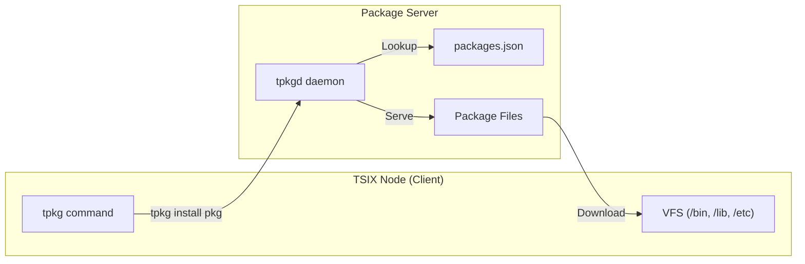
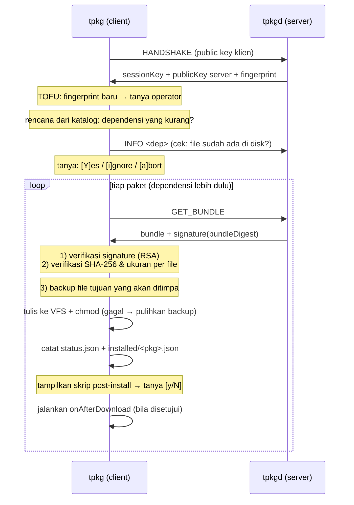
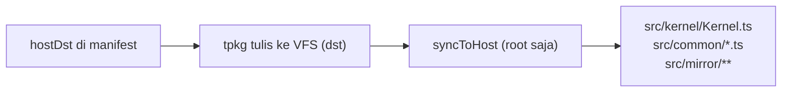

# 📦 Package Manager (TPKG)

TPKG adalah package manager bawaan TSIX untuk menginstall, update, dan mengelola software packages.

Selain paket aplikasi, TPKG dapat memperbarui paket fondasi `base-system`, termasuk
kernel dan komponen host penting. Paket ini dibangun dari kepemilikan file paket,
bukan dari paket sapu-jagat `system-update`.

---

## Arsitektur



---

## Perintah TPKG

| Perintah                                        | Fungsi                                                                          |
| ----------------------------------------------- | ------------------------------------------------------------------------------- |
| `tpkg update [host[:port]]`                     | Ambil katalog paket dari server → simpan ke `/var/cache/tpkg/repo.json`         |
| `tpkg list`                                     | Tampilkan paket di katalog lokal (+ penanda terpasang / versi baru)             |
| `tpkg list --installed`                         | Paket yang terpasang lewat tpkg + versi katalog (`⬆ x.y.z available`)           |
| `tpkg info <pkg> [--from <host[:port]>]`        | Detail satu paket (versi, dependensi, daftar file)                              |
| `tpkg install <pkg...> [--from <host[:port]>]`  | Ambil → verifikasi → backup → tulis → post-install (+ dependensi, dikonfirmasi) |
| `tpkg upgrade [pkg...]`                         | Pasang versi katalog untuk paket terpasang yang lebih tua                       |
| `tpkg remove <pkg...>`                          | Hapus file paket + sidecar `.js`; konfigurasi dikonfirmasi per berkas           |
| `tpkg download <pkg> [--from <host[:port]>]`    | Ambil & verifikasi TANPA menulis ke VFS                                         |
| `tpkg verify <pkg> [--from <host[:port]>]`      | Periksa signature paket dari server                                             |
| `tpkg metrics`                                  | Statistik client                                                                |
| `tpkg -v`, `tpkg --version`                     | Versi klien tpkg + protokol, versi paket `tpkg`/`base-system`, repo default     |
| `tpkg --set-repo <host[:port]>`                 | Simpan repository default                                                       |

Opsi umum:

| Opsi           | Fungsi                                                                                  |
| -------------- | --------------------------------------------------------------------------------------- |
| `-y`, `--yes`  | Jawab "ya" untuk konfirmasi biasa. **Tidak** berlaku untuk fingerprint repo & tulis-host |
| `--no-scripts` | Jangan jalankan skrip post-install / undo                                               |
| `--no-deps`    | Abaikan `depends`                                                                       |
| `--force`      | Pasang ulang walau versi lokal sama/lebih baru                                          |
| `--source`     | Minta varian **source** (`.ts`) — default **binary** (`.js` hasil compile server)        |

### Varian bundle: binary (default) vs source

`tpkgd` meng-compile `.ts` program ke `.js` (tanpa sourcemap) saat membuat bundle —
paket "tinggal pakai" untuk end user, tanpa post-install `transpile`:

| | binary (default) | source (`--source`) |
| --- | --- | --- |
| Program `.ts` | dikirim sebagai `.js` | dikirim `.ts` + `transpile` di klien |
| `/lib/**`, item host (`hostDst`/`/hostsrc`) | tetap `.ts` | `.ts` |
| Post-install `transpile` | dilewati (`prebuilt .js — no build step needed`) | ditanyakan seperti biasa |

- Signature tetap menutupi isi yang benar-benar dikirim (digest dihitung dari `.js`).
- Skrip post-install/undo yang ikut di-compile dipanggil lewat `.js`-nya
  (`/opt/app/configure.ts` → `/opt/app/configure.js`).
- Compile gagal untuk satu berkas → berkas itu dikirim `.ts` (dicatat di log tpkgd
  dan sebagai warning `tpkgd --check`), lalu di-build `transpile` di klien.
- **Source → binary:** `.ts` lama milik paket itu dibuang, karena resolver import
  relatif mendahulukan `.ts` di atas `.js` (kode lama akan menang diam-diam). `.ts`
  yang sudah diubah operator dipindah ke `<file>.ts.tpkg-old`.
- **Image produksi** (`/etc/tsix-release` berisi `VARIANT=production`, ditulis
  `twrapper --no-mirror`): item dengan `hostDst` `src/mirror/<p>` dipasang ke VFS di
  `/<p>` saja — tanpa sinkron ke host — lalu di-compile ke `.js`. Item kernel,
  `src/common`, dan userland tetap ke host. Tanpa ini, `tpkg install base-system`
  menghidupkan lagi `src/mirror/` di host dan `install.ts` salah mengira mode
  development. Dilakukan setelah verifikasi signature (yang menutupi `hostDst` asli).
- `onAfterDownload` di katalog memakai `/sbin/transpile.js`; `EXEC` juga melayani
  path `.ts` yang tidak ada dengan `.js`-nya (image produksi tidak punya `.ts`).

Semua perintah yang **mengubah sistem** — `update`, `install`, `upgrade`, `remove`,
`download` — **wajib root** (`sudo`). Yang boleh tanpa root: `list`, `info`,
`verify`, `metrics`, `--set-repo`.

> `tpkg rollback` **sudah dihapus** (2026-11-26). Rollback hanya memulihkan `.ts`,
> sementara sidecar `.js` hasil transpile versi baru tetap tinggal — dan karena
> `EXEC` mendahulukan `.js`, kode baru tetap yang jalan. Untuk melepas paket pakai
> `tpkg remove`.

Itu bukan sekadar sopan santun: paket **base-system** menulis ke HOST FS
(kernel & komponennya), dan syscall `SYNC_TO_HOST` di kernel sendiri juga menolak
non-root. Jadi tanpa root, paket itu pasti gagal separuh jalan — lebih baik ditolak
di depan dengan pesan jelas.

`tpkgd` juga wajib root: ia memakai kunci identitas privat `/etc/keys/rsa` dan
menyajikan file sistem (termasuk kernel) ke node lain.

```bash
# Set repository sekali, lalu perintah lain tidak perlu --from lagi
tpkg --set-repo pkgserver.local:8090

# Ambil katalog, lihat isi, install (dependensi ditawarkan otomatis)
sudo tpkg update
tpkg list
sudo tpkg install retroterm

# Cek dulu tanpa menyentuh VFS
sudo tpkg download retroterm
tpkg verify retroterm

# Apa yang terpasang & apa yang bisa di-upgrade
tpkg list --installed
sudo tpkg upgrade

# Hapus paket bila sudah tidak dipakai (konfigurasi dikonfirmasi per berkas)
sudo tpkg remove retroterm
```

### Port repository

Format alamat adalah `host[:port]`. Tanpa port, dipakai `80` (tidak lagi
di-hardcode seperti versi lama — port benar-benar dikirim ke jaringan).

---

## Alur Instalasi (aman-by-default)



Empat lapis pengamanan sebelum satu byte pun ditulis:

1. **Session terenkripsi** — handshake RSA + session key ChaCha20.
2. **Trust on first use (TOFU)** — klien menghitung sendiri SHA-256 dari public key
   repo yang dikirim server (kunci yang nanti memverifikasi signature), lalu
   mencocokkannya dengan `/etc/tpkg/trusted_repos` per host (format `<host> <fp>`,
   seperti `known_hosts`). Host baru → harus disetujui operator. Kunci untuk host
   yang sudah dikenal berubah → koneksi **ditolak** tanpa prompt (indikasi
   MITM/server diganti); hapus baris host itu secara manual jika perubahan memang
   sah. Field `fingerprint` kiriman server tidak menentukan kepercayaan.
   Baris format lama (fingerprint pendek tanpa host) diabaikan, jadi repo yang
   dulu sudah dipercaya akan ditanyakan sekali lagi.
3. **Signature paket** — server menandatangani digest bundle (`path+size+sha256`,
   bukan konten penuh) dengan kunci identitas sistem `/etc/keys/rsa`.
4. **Integritas per file** — ukuran dan SHA-256 tiap file diperiksa **sebelum**
   file itu ditulis. Hash dihitung atas byte latin1 (1 char = 1 byte), sama persis
   dengan yang ditulis ke VFS — bukan utf8.

Kalau salah satu gagal, instalasi dibatalkan dan pesannya menyebut file mana yang
bermasalah.

### Konfigurasi `/etc` tidak ditimpa (conffile)

Paket boleh membawa konfigurasi default (mis. `/etc/tpkg/config.json`,
`/etc/dome/dome.conf`). Saat install/upgrade, berkas di `/etc/` yang sudah ada:

| Kondisi berkas di node                                   | Hasil                                             |
| -------------------------------------------------------- | ------------------------------------------------- |
| Isinya sama dengan versi paket                           | Ditulis (tidak ada beda)                          |
| Isinya sama dengan yang dipasang tpkg dulu (tidak diubah) | Ditulis → ikut versi baru                         |
| Diubah operator, atau sudah ada sebelum tpkg (image)     | **Dibiarkan**; versi paket → `<file>.tpkg-new`    |

```
  ~ /etc/tpkg/config.json kept (locally modified) — new version saved as /etc/tpkg/config.json.tpkg-new
```

Bandingkan sendiri lalu gabungkan bila perlu. `.tpkg-new` tercatat di manifest
sehingga ikut terhapus oleh `tpkg remove`. (Dulu reinstall `tpkg` mengembalikan
`defaultRepo` ke repo bawaan paket walau node sudah `tpkg --set-repo`.)

### Skrip post-install wajib disetujui

Skrip `onAfterDownload` berjalan sebagai **root** — paket jahat (atau repo yang
dibobol) bisa melakukan apa saja lewat skrip ini. Karena itu tpkg **tidak**
menjalankannya diam-diam:

```
✅ Package installed. Post-install script: /sbin/transpile.ts
   args: /opt/retroterm/retroterm.ts
   (system script, not part of this package)
Run post-install script? [y/N]:
```

- Skrip yang **dikirim oleh paket itu sendiri** diberi peringatan kuning
  (`shipped by the package itself`) — itu yang paling perlu dicurigai.
- Default **tidak**. Kalau dilewati, tpkg mencetak perintah lengkap untuk dijalankan
  manual, dan memperingatkan bila sidecar `.js` lama masih ada (kode lama tetap
  yang jalan sampai di-transpile ulang).
- Post-install gagal → file paket tetap terpasang; tpkg mencetak perintah untuk
  mengulang, atau sarankan `tpkg remove`.
- Otomasi: `-y` menyetujui, `--no-scripts` melewati.

### Dependensi

Paket boleh menyebut paket lain yang dibutuhkan lewat `depends`
(`"emerald"` atau `"emerald>=1.2.0"`). Saat `install`/`upgrade`, tpkg menyusun
urutan dari katalog (dependensi **lebih dulu**, transitif), lalu bertanya:

```
Additional packages required:
  • emerald              v1.0.0   (not installed; required by retroterm)
Install dependencies? [Y]es / [i]gnore / [a]bort:
```

- Dependensi dianggap terpenuhi bila tercatat di `status.json` dengan versi cukup,
  **atau** semua file-nya sudah ada di disk — node yang dibangun dari image tidak
  punya `status.json`, tapi emerald dkk. sudah ada; tpkg mengeceknya lewat `INFO`.
- Siklus, paket yang tidak ada di katalog, atau versi katalog yang terlalu tua
  dilaporkan dan operator memilih lanjut atau batal.
- `tpkg remove` memperingatkan bila paket masih dibutuhkan paket terpasang lain.
- Isi `depends` di `packages.json` diturunkan dari **import nyata** antar paket
  (base-system tidak ditulis karena semua paket membutuhkannya).

---

## Package Format

Packages didefinisikan dalam `packages.json` di node server:

```json
{
    "version": "1.0",
    "packages": [
        {
            "name": "hello-world",
            "version": "1.0.0",
            "description": "Sample package for TPKG testing",
            "author": "Antigravity",
            "needReboot": false,
            "onAfterDownload": "/opt/test/hello-pkg.ts",
            "items": [
                {
                    "src": "/opt/test/hello-pkg.ts",
                    "dst": "/opt/test/hello-pkg.ts",
                    "isExecutable": true
                },
                {
                    "src": "/etc/pkg-demo.conf",
                    "dst": "/root/bucket/pkg-demo.conf"
                }
            ]
        }
    ]
}
```

### Field paket

| Field             | Deskripsi                                        |
| ----------------- | ------------------------------------------------ |
| `name`            | Nama unik package                                |
| `version`         | Versi semver                                     |
| `description`     | Deskripsi singkat                                |
| `author`          | Opsional, informasi                              |
| `needReboot`      | `true` → operator diminta reboot setelah install                          |
| `onAfterDownload` | Skrip setelah instalasi berhasil (dikonfirmasi operator)                  |
| `undoScript`      | Opsional, dijalankan saat `tpkg remove` sebelum file dihapus (dikonfirmasi) |
| `depends`         | Opsional, paket yang dibutuhkan: `["emerald", "cashew>=1.1.0"]`           |
| `minVersion`      | Versi TSIX minimum (informasi, belum ditegakkan)                          |
| `items[]`         | Daftar file yang dikirim                                                  |

### Field item

| Field          | Deskripsi                                                                                                                                     |
| -------------- | --------------------------------------------------------------------------------------------------------------------------------------------- |
| `src`          | Path sumber di sisi server (path VFS, atau `/hostsrc/...` untuk file host — lihat [Base-System](#base-system-fondasi-dan-infrastruktur-host)) |
| `dst`          | Path tujuan di sisi klien (absolut)                                                                                                           |
| `hostDst`      | **Opsional.** Tujuan tambahan di HOST, relatif root proyek (mis. `src/kernel/Kernel.ts`). File ber-`hostDst` ditulis ke VFS **dan** ke host   |
| `permissions`  | Mode chmod eksplisit (mis. `493` = `0o755`). Menang atas `isExecutable`                                                                       |
| `isExecutable` | `true` → chmod `0o755`                                                                                                                        |

Urutan penentuan mode: `permissions` → SetUID (`/bin/login|passwd|sudo` → `0o4755`)
→ `isExecutable` → direktori eksekusi (`/bin`, `/usr/bin`, `/opt` → `0o755`;
`/sbin` → `0o744`) → mode bawaan VFS (`0o644`). Aturan direktorinya punya **satu
sumber**: `execModeForPath()` di `src/mirror/lib/TpkgProtocol.ts`, dipakai `tpkg`,
`transpile`, `apply-update`, dan di sisi host `scripts/lib/binary-mode.ts`
(bootstrap/install/sync/pull) — jadi hasil `tpkg install` identik dengan bootstrap.
Sidecar `.js` buatan `transpile` selalu executable (`0o755` di luar direktori exec).

> ⚠️ **Catatan penting:** file executable di luar direktori eksekusi **wajib** memakai
> `isExecutable: true` atau `permissions`. Tanpa itu file ditulis `0o644` dan
> skrip post-install gagal dengan error 126 (_Permission denied_).
>
> File **data** di dalam direktori eksekusi (mis. `/opt/esp-ota/activation-keys.txt`)
> sengaja **tidak** ikut di-chmod `0o755` — hanya `.ts`/`.js` yang diperlakukan
> sebagai program.

### Batas ukuran

`tpkgd` menolak paket yang melebihi `--max-bundle` (default **4 MB**) dengan pesan
jelas, bukan crash/OOM. Bundle dikirim dalam satu pesan MQTNL sehingga manifest
dengan file raksasa (ratusan MB) tidak akan tertangani — pecah paketnya atau
gunakan `host` mount untuk file besar. Paket aplikasi TSIX pada umumnya ≤ 188 KB;
paket base-system membawa infrastruktur host dan shared runtime yang diperlukan.

---

## Memperbarui Sistem

1. `tpkg update` mengambil katalog paket ke `/var/cache/tpkg/repo.json`
2. `tpkg download <pkg>` mengambil file paket ke `/var/cache/tpkg/bundles/<pkg>/<versi>/`
3. `tpkg install <pkg>` menulis ke VFS (+ host untuk `base-system`) lalu menjalankan
   `onAfterDownload`
4. Reboot bila `needReboot: true`

```bash
sudo tpkg update                 # katalog
sudo tpkg download base-system   # opsional: ambil & verifikasi lebih dulu
sudo tpkg install base-system    # perbarui fondasi dan infrastruktur host
reboot
```

---

## Base-System: Fondasi dan Infrastruktur Host

`base-system` adalah fondasi image dan jalur pembaruan infrastruktur node. Isinya
gabungan file VFS dasar yang dikurasi di `packages.json` dengan file kernel,
bootloader worker, shared runtime, dan VFS base yang perlu disinkronkan ke host.
Aplikasi seperti Lantana, desktop, network tools, dan driver opsional tetap punya
paket domain masing-masing, bukan ikut tersalin sebagai satu paket system-wide.

### Batas paket

| Bagian                                      | Tujuan                                  | Cara dipasang                           |
| ------------------------------------------- | --------------------------------------- | --------------------------------------- |
| VFS base yang dikurasi                      | VFS + `src/mirror/**` host mirror       | Ditulis ke VFS dan host lewat `hostDst` |
| `src/common/**/*.ts`                        | `/lib/common/**` + host `src/common/**` | VFS seed dan host mirror                |
| `src/kernel/**`                             | Host filesystem                         | Staging VFS lalu `syncToHost`           |
| `WorkerEntry.ts` dan `VfsModuleResolver.ts` | Host filesystem                         | Staging VFS lalu `syncToHost`           |

Daftar kernel/common/bootloader dihasilkan dari source tree; file VFS base tetap
ditentukan oleh pemilik paket masing-masing. Jalankan:

```bash
npm run tpkg:manifest          # rekonsiliasi base-system dan seluruh katalog
npm run tpkg:manifest -- --dry # preview tanpa menulis
```

Versi paket mengikuti versi kernel di `src/kernel/Kernel.ts`.

### Kenapa ada `hostDst`

Kernel dan bootloader worker hidup di **host filesystem**, bukan di VFS — paket
biasa tidak bisa menyentuhnya. Field `hostDst` menandai file yang harus keluar dari
VFS. Alurnya:



Tujuannya **dua**: memperbarui sistem yang berjalan (VFS) **dan** menjaga source
mirror di host tetap sinkron. Kalau repo tertinggal, `npm run vfs:bootstrap`
berikutnya bisa mengembalikan file host yang lebih lama.

Di sisi server, file host biasanya dibaca lewat mount read-only `/hostsrc` → `src`
(lihat `src/mirror/etc/fstab.conf`, mode `0o700` — hanya root). Jika mount itu
tidak tersedia, `tpkgd` root membaca item `/hostsrc/...` lewat `SYNC_FROM_HOST`
dan staging sementara di `/tmp`; path sumber tetap divalidasi agar tidak bisa
keluar dari root proyek.

### Pengaman

- **Wajib root** (`sudo`) — gerbang di CLI, dan kernel juga menolak `SYNC_TO_HOST`
  dari non-root.
- Daftar file host **ditampilkan lebih dulu** dan harus dikonfirmasi
  (`Proceed with writing to host? [y/N]`, default **tidak**; `-y` tidak berlaku).
- `hostDst` divalidasi di **server dan klien** (`isSafeHostDst`): harus relatif,
  tanpa `..`, tanpa path absolut. Nilai yang tidak aman → paket ditolak.
- `hostDst` **ikut ditandatangani** (masuk `bundleDigest`), jadi pihak ketiga tidak
  bisa membelokkan file base/kernel ke path lain walau signature tetap valid.
- Backup mencakup **kedua sisi**: file VFS **dan** file host, sehingga instalasi
  yang gagal di tengah penulisan bisa mengembalikan kernel yang sudah tertimpa.
- File host yang benar-benar baru tidak bisa dihapus otomatis (VFS tidak punya
  syscall untuk itu) → dilaporkan ke operator, bukan gagal diam-diam.

### Sidecar `.js` dibangun ulang setelah instalasi

Yang dieksekusi bukan `.ts`, tapi sidecar `.js`:
`tsh` mencari command lewat PATH dengan urutan `.js` **sebelum** `.ts`, dan
`sysconfig.conf` menyebut `bootEntry = init.js`. Tanpa langkah ini,
`/bin/init.js` & `/bin/ls.js` tetap versi lama dan update seolah tidak terjadi.

Karena itu paket ini memakai `onAfterDownload: /sbin/apply-update.ts`, yang:

1. membangun ulang seluruh sidecar `.js` di `/bin`, `/sbin`, `/usr/bin`;
2. membangun ulang sidecar host `src/userland/WorkerEntry.js` (dimuat langsung Node);
3. menegakkan mode eksekusi + SetUID (`login`, `passwd`, `sudo`).

### Yang SENGAJA tidak ikut

Data milik node tidak boleh disebar ke node lain:

| Tidak dikirim                                  | Alasan                                                                     |
| ---------------------------------------------- | -------------------------------------------------------------------------- |
| `/etc/passwd`, `/etc/shadow`, `/etc/group`     | Akun server akan menggantikan akun node tujuan                             |
| `/etc/tpkg/trusted_repos`, `/etc/tpkg/keys/**` | Kepercayaan (TOFU) & kunci per node                                        |
| `/etc/fstab.conf`, `/etc/crontab`              | Mount & jadwal tugas per node                                              |
| `/etc/<app>/*.json` (lantana, telechat, dst.)  | Pengaturan operator; engine update tidak boleh mengembalikannya ke default |

Yang tetap dikirim dari `/etc` hanya: `profile`, `rc.local`, `motd`, `motd.json`,
`fstab.md`, `tpkg/packages.json`.

> `profile`, `rc.local`, katalog TPKG, kredensial, dan konfigurasi node-local bukan
> bagian dari payload `base-system`; paket ini tidak menimpa pengaturan operator.

---

## Backup (pemulihan instalasi yang gagal)

Sebelum menimpa file, tpkg membackup isi lama ke disk:

```
/var/lib/tpkg/backup/<pkg>/<timestamp>/<0001.bin, 0002.bin, ...>
/var/lib/tpkg/backup/<pkg>/<timestamp>/index.json
```

`index.json` mencatat per file: path tujuan, apakah file sudah ada sebelumnya, dan
nama file backup. Status versi terpasang ada di `/var/lib/tpkg/status.json`.

- Gagal menulis backup → instalasi **dibatalkan** (tidak lanjut menimpa file).
- Penulisan gagal di tengah jalan → file dipulihkan otomatis
  (`↩️  Previous files restored ...`) — terjadi **sebelum** ada sidecar baru, jadi
  hasilnya konsisten.
- Hanya backup terbaru yang disimpan per paket.

---

## Menghapus Paket (`tpkg remove`)

`tpkg remove <pkg...>` menghapus semua file yang pernah ditulis paket. Daftar file
diambil dari manifest yang dibuat saat install:
`/var/lib/tpkg/installed/<pkg>.json` (berisi path + sha256 tiap file). Untuk paket
lama yang dipasang sebelum manifest ada, dipakai `index.json` backup terbaru.

- **Sidecar `.js`** di samping tiap `.ts` paket ikut dihapus. Sidecar dibuat
  `transpile` setelah instalasi sehingga tidak tercatat di manifest — dulu
  tertinggal, dan programnya masih bisa dijalankan walau paketnya sudah dihapus.
- **File bersama** (dipasang juga oleh paket terpasang lain, mis. `/sbin/tpkg.ts`
  di `base-system` dan `tpkg`) **dibiarkan** — `kept … (also installed by …)`.
- Paket yang masih **dibutuhkan** paket terpasang lain → peringatan + konfirmasi.
- `undoScript` paket (kalau ada) ditampilkan dan dijalankan **setelah disetujui**.

Berkas **konfigurasi** (`.conf`, `.cfg`, `.cnf`, `.ini`, `.json`, `.yaml`,
`.yml`, `.toml`, `.env`, `.properties`, `.xml`) tidak dihapus diam-diam — selalu
ditanya:

```
Config file /etc/app.conf (modified) — [r]emove / [a]ll / [c]ancel:
```

- `r` — hapus berkas ini saja
- `a` — hapus berkas ini dan sisanya tanpa tanya lagi
- `c` — berhenti; sisa berkas dibiarkan dan `status.json` tidak diubah

Penanda `(modified)` muncul bila sha256 isi sekarang berbeda dengan saat
install — supaya perubahan lokal tidak hilang tanpa sadar. Berkas host
(`hostDst`) tidak bisa dihapus lewat VFS dan akan dilaporkan untuk dihapus manual.

---

## TPKGD (Package Daemon)

`tpkgd` adalah daemon server-side yang melayani package repository.

```bash
tpkgd [--port <n>] [--repo <path>] [--max-bundle <bytes>] [--check] [--help]
```

| Opsi           | Default                   | Keterangan                                   |
| -------------- | ------------------------- | -------------------------------------------- |
| `--port`       | `80`                      | Port UDP/MQTNL yang didengarkan              |
| `--repo`       | `/etc/tpkg/packages.json` | Manifest paket                               |
| `--max-bundle` | `4194304` (4 MB)          | Batas total bundle yang dilayani             |
| `--check`      | —                         | Validasi manifest lalu keluar (tanpa daemon) |

### `tpkgd --check` — validasi manifest sebelum diterbitkan

```bash
sudo tpkgd --check
```

Bundle tiap paket dibangun lewat jalur yang **sama** dengan saat melayani klien,
jadi hasil "OK" berarti paket memang bisa dikirim. Yang diperiksa:

- **Error:** JSON rusak, `name`/`version`/`items` hilang, nama ganda, file sumber
  tidak ada, `hostDst`/`/hostsrc` tidak aman, bundle melebihi `--max-bundle`,
  dependensi tidak dikenal / rusak / bergantung pada diri sendiri / siklus.
- **Warning:** file yang dikirim lebih dari satu paket, skrip
  `onAfterDownload`/`undoScript` yang tidak dikirim paket mana pun dan tidak ada
  di node ini.

Perilaku:

- Bind socket + pin framing MQTNL (JSON) supaya protokol tidak tertukar peer lain,
  lalu daemonize.
- Melayani `LIST` (katalog), `INFO <pkg>` (detail), `GET_BUNDLE <pkg>` (file + signature).
- Saran nama paket ala "did you mean" (Levenshtein) kalau paket tidak ada.
- Rate limit per pengirim (120 permintaan/menit) → permintaan berlebih ditolak
  `RATE_LIMITED`, bukan diam-diam.
- Session punya TTL 10 menit; sweep dijalankan saat idle (throttle 30 detik) sehingga
  daemon tidak menahan state mati.
- `tpkgd --help` mencetak opsi yang tersedia; `--port` tidak valid ditolak dengan
  pesan jelas **sebelum** bind.

---

## Troubleshooting

| Gejala                                                  | Penyebab & solusi                                                                                                                                              |
| ------------------------------------------------------- | -------------------------------------------------------------------------------------------------------------------------------------------------------------- |
| `requires root privileges`                              | Jalankan dengan `sudo`                                                                                                                                         |
| `did not respond to handshake`                          | Server mati / port salah. Cek `--from host:port` dan `tpkgd --port`                                                                                            |
| `Package '<x>' not found in catalog`                    | Jalankan `tpkg update` dulu, atau server belum punya paket itu                                                                                                 |
| Post-install error **126**                              | File tidak executable → tambahkan `isExecutable: true`                                                                                                         |
| `exceeds limit` saat bundle                             | Paket > `--max-bundle` → naikkan batas atau pecah paket                                                                                                        |
| Program lama tetap jalan setelah install                | Post-install `transpile` dilewati → sidecar `.js` lama masih menang. Jalankan perintah `sudo /sbin/transpile.ts …` yang dicetak tpkg                           |
| `… is not a function` setelah paket mengubah `/lib`     | Kernel meng-compile `/lib/*.ts` ke cache **hanya saat boot** → program memakai lib lama. Reboot; tpkg kini memperingatkan `framework libraries in /lib were updated` |
| Masalah manifest baru ketahuan di klien                 | Jalankan `sudo tpkgd --check` di server sebelum menerbitkan                                                                                                    |
| Fingerprint berubah                                     | Server di-reinstall/kunci diganti, atau MITM. Verifikasi dulu                                                                                                  |
| `RATE_LIMITED`                                          | Terlalu banyak permintaan dari satu pengirim, tunggu 1 menit                                                                                                   |
| `requires root privileges`                              | Jalankan dengan `sudo` — `base-system` dapat menulis ke host FS                                                                                                |
| Update engine tidak berefek setelah reboot              | Sidecar `.js` belum dibangun ulang → setujui post-install `/sbin/apply-update.ts`, atau jalankan manual `sudo /sbin/apply-update.ts`                           |
| `unsafe hostDst`                                        | Manifest salah: `hostDst` harus relatif, tanpa `..`/absolut                                                                                                    |
| Backup host gagal                                       | `syncFromHost` butuh root & file host harus bisa dibaca                                                                                                        |
| `Local module scan failed: File not found: /common/...` | Bug loader lama (sudah dibetulkan 2026-09-22): resolver modul relatif menembus root VFS. Pastikan sidecar `src/userland/VfsModuleResolver.js` sudah di-rebuild |

---

Changelog: [`changelogs/tpkg.md`](changelogs/tpkg.md) (2026-11-26).

---

**Halaman selanjutnya:** [🔐 Keamanan & Sandboxing](Keamanan-dan-Sandboxing.md)
