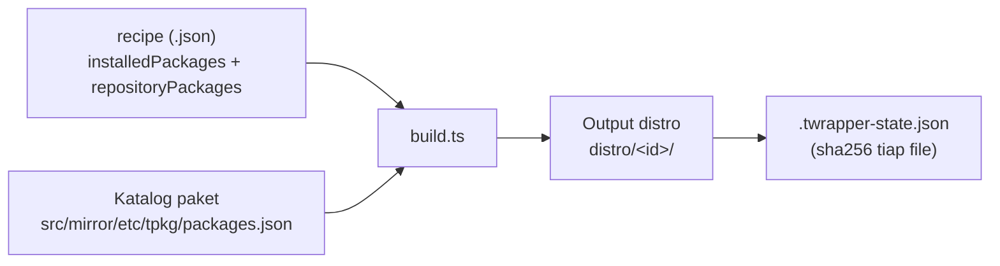

# 📦 Twrapper

Twrapper adalah pembangun image distro TSIX yang **berbasis nama paket TPKG**, bukan daftar file. Kamu cukup mendeklarasikan "distro ini berisi paket A, B, C", lalu Twrapper menyusun seluruh isi image dari katalog paket `src/mirror/etc/tpkg/packages.json`.

Hasilnya adalah direktori distro yang siap di-`npm install` + dijalankan, lengkap dengan repository TPKG lokal untuk pengujian instalasi paket.

> Berbeda dengan generator lama berbasis inventaris file (`scripts/distro-generator.ts`, yang sudah dihapus), Twrapper menjaga satu aturan penting: **satu file dimiliki satu paket**. Kalau dua paket menargetkan path output yang sama dengan isi berbeda, build langsung gagal.

---

## Ringkasan cepat

Twrapper bisa punya **banyak resep** (`*.json`). Resep menentukan isi distro sekaligus `outputDirectory`-nya, jadi pilih resep lewat `--recipe <path>`:

```sh
# 1. Pastikan katalog paket mutakhir
npm run tpkg:manifest

# 2. Cek rencana build (tanpa menulis apa pun)
#    Tanpa --recipe → memakai resep DEFAULT: scripts/twrapper/imut.json
npm run distro:twrapper -- --check

# 3. Bangun image dari resep default → distro/imut/
npm run distro:twrapper

# Memilih resep lain secara eksplisit (mis. scripts/twrapper/lab.json → distro/lab/)
npm run distro:twrapper -- --recipe scripts/twrapper/lab.json
```

> **Resep default:** kalau `--recipe` tidak diberikan, Twrapper memakai `scripts/twrapper/imut.json` (hasil di `distro/imut/`). Untuk distro lain, selalu sebutkan `--recipe`-nya agar jelas resep mana yang dipakai.

---

## Arsitektur



Twrapper **tidak membaca daftar file** secara manual. Ia:

1. Memuat recipe (default `scripts/twrapper/imut.json`).
2. Memvalidasi recipe & katalog.
3. Mengambil paket `installedPackages` → disalin langsung ke image.
4. Mengambil paket `repositoryPackages` → di-_stage_ ke `/var/lib/tpkg/repo/<pkg>/...` di dalam image, dan katalog memuat ulang hanya paket repo tersebut.
5. Menambahkan berkas installer/bootstrap, `src/common`, `src/vfs`, dan override rootfs.
6. Menulis semua ke `outputDirectory`, disertai state hash untuk keamanan.

---

## Skema recipe

Recipe adalah satu file JSON, misalnya `scripts/twrapper/imut.json`:

```json
{
    "schemaVersion": 1,
    "distro": {
        "id": "imut",
        "name": "TSIX Imut",
        "version": "0.1.0-draft",
        "status": "draft",
        "description": "Distro minimal TSIX untuk menguji instalasi paket TPKG.",
        "purpose": ["..."],
        "features": ["..."]
    },
    "outputDirectory": "distro/imut",
    "installedPackages": ["base-system", "coreutils", "tpkg"],
    "repositoryPackages": ["procutils", "nettools", "hello-world", "display-drivers", "joystick-driver"]
}
```

Aturan validasi:

| Field                                       | Aturan                                                         |
| ------------------------------------------- | -------------------------------------------------------------- |
| `schemaVersion`                             | Wajib `1`.                                                     |
| `distro.id/name/version/status/description` | String tidak kosong.                                           |
| `distro.purpose`, `distro.features`         | Array string tidak kosong.                                     |
| `installedPackages`, `repositoryPackages`   | Array string tidak kosong.                                     |
| Nama paket                                  | Unik lintas dua daftar; cocok `^[a-zA-Z0-9][a-zA-Z0-9+._-]*$`. |
| `outputDirectory`                           | Path relatif; **wajib** di dalam `distro/`.                    |

### installedPackages vs repositoryPackages

- **`installedPackages`** — sudah terpasang di image sejak boot. File-nya disalin langsung ke lokasi VFS aslinya (`src/mirror/<dst>`), dan untuk item ber-`hostDst` ikut disalin ke path host-nya.
- **`repositoryPackages`** — _tidak_ terpasang, tetapi tersedia di repository lokal di dalam image (`/var/lib/tpkg/repo/<pkg>/...`) sehingga bisa diuji dengan `tpkg install <pkg>`.

> Nama paket **harus** ada di katalog `src/mirror/etc/tpkg/packages.json`. Pastikan menjalankan `npm run tpkg:manifest` lebih dulu.

---

## Cara Twrapper memetakan file

Setiap `item` paket TPKG punya `src` (path VFS) dan `dst`. Twrapper menerjemahkannya ke path sumber di repo & path output image:

| Pola `src`           | Sumber di repo     | Output untuk paket **installed**             |
| -------------------- | ------------------ | -------------------------------------------- |
| `/hostsrc/<rel>`     | `src/<rel>`        | `hostDst` (path host, mis. `src/kernel/...`) |
| `/lib/common/<rel>`  | `src/common/<rel>` | `src/mirror/<dst>`                           |
| lainnya (`/bin/...`) | `src/mirror/<src>` | `src/mirror/<dst>`                           |

Untuk item yang punya `hostDst` **dan bukan** `/hostsrc/`, Twrapper menyalin ke **dua** tempat: ke `src/mirror/<dst>` dan ke `hostDst`.

Item dengan `src` = `/etc/tpkg/packages.json` dilewati, karena katalog image dibuat ulang dari daftar paket repo.

### Staging repository

Untuk `repositoryPackages`, sumber tidak ditaruh di lokasi VFS final, melainkan di:

```
/var/lib/tpkg/repo/<pkg>/<path-relatif>
```

`item.src` di katalog hasil ditulis ulang menunjuk ke path staged tersebut, sehingga `tpkgd` melayani paket dari repository lokal tanpa harus meng-install-nya.

---

## Berkas yang selalu disertakan

**`INSTALLER_FILES`** (disalin apa adanya): `LICENSE`, `bootstrap.sh`, `bootstrap.bat`, `package.json`, `package-lock.json`, `tsconfig.json`, `scripts/install.ts`, beberapa `scripts/lib/*.ts`, `src/main.ts`, `src/sysconfig.conf`, serta sidecar `src/userland/WorkerEntry.js` dan `src/userland/VfsModuleResolver.js`.

**Direktori yang di-_walk_** — semua `*.ts`/`*.js`/`*.json` (kecuali `*.test.*`/`*.spec.*` dan file berawalan titik):

- `src/common/**`
- `src/vfs/**`

### Override rootfs

Tiga berkas berikut **selalu menimpa** hasil paket (dipakai untuk rasa distro):

- `scripts/twrapper/rootfs/etc/profile` → `src/mirror/etc/profile`
- `scripts/twrapper/rootfs/etc/rc.local` → `src/mirror/etc/rc.local`
- `scripts/twrapper/rootfs/etc/tpkg/config.json` → `src/mirror/etc/tpkg/config.json`

Contohnya `rc.local` menjalankan `tpkgd` saat boot dan `config.json` menunjuk `localhost:8080` sebagai repo default.

### `package.json` hasil build

`scripts.install` dari `package.json` root diganti nama menjadi `scripts["tsix:install"]`, supaya `npm install` tidak otomatis menjalankan bootstrap saat dependency distro dipasang. Setelahnya:

```sh
npm install
npm run tsix:install
```

`README.md` distro juga dibuat otomatis dari isi recipe.

---

## Perintah & opsi

```sh
npm run distro:twrapper -- [opsi]
```

| Opsi              | Arti                                                                       |
| ----------------- | -------------------------------------------------------------------------- |
| _(tanpa opsi)_    | Build recipe default `scripts/twrapper/imut.json`.                         |
| `--recipe <path>` | Pakai recipe lain, mis. `--recipe scripts/twrapper/lab.json`.              |
| `--check`         | Hanya tampilkan rencana (jumlah file + ukuran), **tidak menulis** apa pun. |
| `-h`, `--help`    | Tampilkan bantuan.                                                         |

Contoh keluaran:

```
[twrapper] TSIX Imut: 226 files (2260 KB)
[twrapper] installed packages: base-system, coreutils, tpkg
[twrapper] repository packages: procutils, nettools, hello-world, display-drivers, joystick-driver
[twrapper] output: distro/imut
[twrapper] build complete
```

> Alias `npm run distro:twrapper` setara dengan `node -r esbuild-register scripts/twrapper/build.ts`. Argumen Twrapper harus didahului `--`, mis. `npm run distro:twrapper -- --check`.

---

## Keamanan output & state

Twrapper menolak menimpa pekerjaan yang bukan miliknya:

- `outputDirectory` **wajib** di dalam `distro/` (mencegah builder menulis ke lokasi sembarangan).
- Direktori output yang **tidak kosong tetapi tanpa** `.twrapper-state.json` → build ditolak (`Refusing to overwrite unmanaged output directory`).
- Setiap file yang pernah dihasilkan dicatat di `.twrapper-state.json` beserta **sha256**-nya.
- Jika sebuah file hasil build sudah **diubah manual** (hash tidak cocok) → build ditolak (`Refusing to overwrite modified or unverified generated file`).
- File hasil build yang **tidak lagi** diproduksi oleh recipe baru akan dihapus.

Konsekuensinya: **jangan mengedit file di dalam `distro/<id>/` secara manual**. Edit sumbernya di repo, lalu build ulang.

---

## Struktur output

```
distro/imut/
├── .twrapper-state.json      # daftar file + sha256 (jangan diedit)
├── README.md                 # dibuat dari recipe
├── package.json              # scripts.tsix:install
├── bootstrap.sh / .bat
├── scripts/                  # installer + lib
└── src/
    ├── main.ts
    ├── userland/             # WorkerEntry.js, VfsModuleResolver.js
    ├── common/, vfs/         # engine
    └── mirror/
        ├── bin/ sbin/ etc/ ...
        └── var/lib/tpkg/repo/ # paket repositoryPackages (staged)
```

---

## Alur uji (contoh: Imut)

Setelah build:

```sh
cd distro/imut
npm install
npm run tsix:install
./bootstrap.sh          # atau bootstrap.bat di Windows
```

Di dalam shell TSIX:

```sh
sudo tpkg update
sudo tpkg info procutils
sudo tpkg install procutils
ps
sudo mem
sudo tpkg install hello-world
sudo tpkg download hello-world
sudo tpkg verify hello-world
```

`tpkgd` sudah otomatis berjalan (lihat `rc.local`), dan repo default menunjuk ke `localhost:8080`.

---

## Membuat distro baru

1. Salin recipe, mis. `scripts/twrapper/lab.json`.
2. Ubah `distro.id`, `distro.name`, `outputDirectory` (harus `distro/<id>`), dan daftar paketnya.
3. Pastikan setiap paket ada di katalog (`npm run tpkg:manifest`).
4. Cek dulu: `npm run distro:twrapper -- --recipe scripts/twrapper/lab.json --check`.
5. Build: `npm run distro:twrapper -- --recipe scripts/twrapper/lab.json`.

---

## Troubleshooting

| Pesan                                                           | Penyebab & solusi                                                                                                      |
| --------------------------------------------------------------- | ---------------------------------------------------------------------------------------------------------------------- |
| `Package '<x>' is not defined in .../packages.json`             | Paket belum ada di katalog. Jalankan `npm run tpkg:manifest`.                                                          |
| `A package may appear only once across ...`                     | Nama paket dobel di `installedPackages`/`repositoryPackages`.                                                          |
| `Twrapper outputDirectory must be inside distro/`               | `outputDirectory` menunjuk keluar `distro/`.                                                                           |
| `Conflicting package payloads target the same path`             | Dua paket memiliki file berbeda untuk tujuan yang sama → perbaiki kepemilikan file di katalog (satu file, satu paket). |
| `Refusing to overwrite unmanaged output directory`              | Folder output tidak kosong dan bukan hasil Twrapper. Kosongkan atau pakai folder lain.                                 |
| `Refusing to overwrite modified or unverified generated file`   | Ada file hasil build yang diubah manual. Kembalikan dari sumber, atau hapus folder lalu build ulang.                   |
| `Source is not a regular file` / `Refusing symlink source path` | Sumber berupa direktori atau symlink; Twrapper hanya menerima file regular non-symlink.                                |

---

## Prinsip yang dipegang Twrapper

- **Komposisi dari paket, bukan daftar file** — sumber kebenaran adalah katalog TPKG.
- **Satu file, satu pemilik** — tidak ada irisan antar paket.
- **Reproducible & aman** — hash per file, tolak tulis ke folder/berkas yang tidak ia miliki.
- **Byte-preserving** — file disalin sebagai byte mentah (tidak ada konversi encoding), sejalan dengan konvensi VFS TSIX (latin1 = 1 char/byte).
